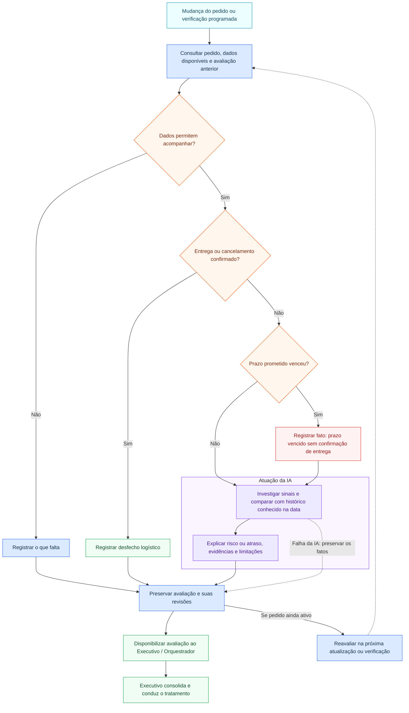

# Primeiro fluxo operacional do Agente Logístico

## Objetivo e situação da entrega

Definir como acompanhar um pedido, identificar prazo vencido e investigar sinais
de atraso antes do vencimento, mantendo o Executivo/Orquestrador informado.
Este documento é o contrato inicial de implementação. O backend atual possui
análises históricas; ainda não possui acompanhamento operacional, estimador de
risco, jobs, persistência de avaliações ou integração entre os agentes.

A atuação da IA está na investigação: escolher comparações pertinentes,
relacionar histórico e evolução do pedido, explicar os sinais encontrados,
reavaliar conclusões e recomendar o encaminhamento. Datas, contagens, cálculos
e transições permitidas são conferidos pelo backend. A IA não deve inventar uma
probabilidade ou uma nova data de entrega para tornar a análise mais conclusiva.

## Alinhamento com o projeto

Foram consultados o fluxo `fluxo_agente_logistico.mmd` e o documento
`TC_Fase2_v10_SugestoesParaAprovacao.docx`, na pasta `fase02` do trabalho. O documento
contém propostas de revisão e descrições de outra implementação; não constitui
evidência de que essas funcionalidades existam neste backend.

| Ponto | Decisão para este projeto |
|---|---|
| Tecnologia | Python/FastAPI, OpenAI Agents SDK e PostgreSQL, em etapas versionadas |
| Executivo | Também é o Orquestrador e recebe alertas, limitações, revisões e desfechos |
| Logística externa | Serviço abstrato de atualização do pedido; nenhuma transportadora ou API específica presumida |
| Dados incompletos | O agente consulta as ferramentas disponíveis e registra a limitação; não solicita esclarecimento humano para completar a análise |
| Contato com vendedor/cliente | Encaminhamento recomendado ao Executivo; envio de mensagens não integra o primeiro incremento |
| Compensações | Fora do escopo acordado |
| Cortes de risco e frequências | Não adotar automaticamente os cortes, 48 horas ou outras políticas do documento em revisão |
| Jornada do Cliente | Recebe contexto quando o Executivo encaminhar o caso; não há canal paralelo que oculte alertas do Orquestrador |

## Participantes e serviços

| Participante | Responsabilidade |
|---|---|
| Serviço de pedidos | Fornecer a situação observada e sua versão; publicar mudanças quando integrado |
| Agendador | Selecionar pedidos ativos próximos do prazo ou com prazo vencido, conforme política futura |
| Agente Logístico | Investigar sinais, interpretar evidências e produzir avaliação estruturada |
| Ferramentas de dados | Consultar o pedido e calcular comparações históricas reproduzíveis |
| Serviço de previsão, quando validado | Produzir estimativa quantitativa com versão e limitações; ainda não implementado |
| Registro operacional | Preservar avaliações, revisões e entrega ao Executivo no schema futuro `application` |
| Executivo/Orquestrador | Consolidar, priorizar e conduzir o tratamento, inclusive encaminhamentos à Jornada ou à operação |

Nenhum desses papéis exige criar um quarto agente. Serviços de dados, jobs e
estimadores são ferramentas da solução, não novas personas de IA.

## Entradas necessárias

| Campo proposto | Origem e uso |
|---|---|
| `order_id` | Identificador do pedido selecionado; unidade principal do acompanhamento |
| `trigger_type` | `order_updated`, `scheduled_check` ou `executive_request` |
| `idempotency_key` | Identificador da solicitação/evento para reconhecer tentativas repetidas |
| `as_of_date` | Data de referência declarada para avaliar o prazo; no replay histórico, representa o dia simulado |
| `source_version`, `source_observed_at` | Versão e momento de observação do estado consultado; metadados a adicionar na integração/simulação |
| `order_status` e datas do pedido | Compra, aprovação, despacho, entrega e previsão, mantendo nomes originais nos dados de origem |
| `seller_ids`, itens e categorias | Vendedores associados ao pedido e contexto de seus itens |
| `seller_state`, `destination_state` | Contexto de origem cadastral e destino; não comprovam a rota física percorrida |
| `previous_assessment_id` | Última avaliação, quando existir, para explicar o que mudou |
| `operational_updates` | Atualizações externas opcionais do serviço abstrato; ausentes no CSV original |

A data de compra identifica quando o pedido nasceu; não identifica quando seu
status foi consultado ou atualizado. `source_observed_at` e `source_version`
devem tornar essa distinção verificável. A política de atualidade desses dados
será configurada e validada na integração; nenhum limite numérico foi definido.

A comparação do prazo usa dias de calendário, coerente com os indicadores:
`as_of_date > date(order_estimated_delivery_date)` significa prazo vencido.
Vencimento no próprio dia ainda não é atraso confirmado por esse critério.
Timestamps originais não recebem conversão implícita de fuso. A data de referência
do negócio deve ser explícita; o instante de auditoria `evaluated_at` terá fuso.

## Sequência de funcionamento

1. **Receber a solicitação e consultar o pedido.** Reconhecer reexecuções pela
   chave de idempotência, obter a versão atual e consultar a avaliação anterior.
   A seleção é por pedido; não interpretar automaticamente todos os pedidos de
   2016–2018 como pedidos abertos na data atual.
2. **Conferir consistência e disponibilidade.** Verificar campos necessários,
   coerência temporal e informações observáveis na data de referência. Consultar
   complementos disponíveis autonomamente. Se restar uma lacuna, registrá-la sem
   inventar valores ou perguntar ao humano como completar o dado.
3. **Reconhecer encerramento ou prazo vencido.** Entrega confirmada ou cancelamento
   encerram o acompanhamento logístico, com resultado conhecido ou indeterminado.
   Entrega sem data pode encerrar o acompanhamento, mas não comprova pontualidade.
   Contradições entre status e datas exigem registrar inconsistência antes de
   concluir o desfecho. Outros status não são tratados como cancelamento sem
   semântica explícita do serviço de pedidos.
4. **Registrar o fato de prazo vencido.** Sem entrega confirmada, prazo vencido
   gera alerta factual para o Executivo. Esse alerta não depende de o modelo
   conseguir explicar a causa. “Sem confirmação” não significa prova de que o
   cliente não recebeu.
5. **Investigar com IA os pedidos em andamento.** Tanto antes quanto depois do
   vencimento, relacionar tempo disponível, tempo desde a compra/despacho,
   vendedores, destino e categorias com grupos históricos pertinentes. O agente
   pode refinar a comparação quando uma amostra for pequena ou pouco comparável.
   A ferramenta devolve critérios, contagens e resultados, sem cálculo mental
   de estatísticas pelo modelo.
6. **Produzir conclusão e recomendação.** Distinguir evidência de risco preventivo,
   ausência de sinal nas evidências consultadas e insuficiência de dados. Para
   prazo vencido, explicar a situação observada e suas limitações. Estimativas
   quantitativas só entram quando uma fonte ou método validado as sustentar.
7. **Preservar e disponibilizar a avaliação.** Registrar fatos, evidências,
   limitações, diferenças em relação à análise anterior e recomendação. Todas
   as avaliações ficam disponíveis ao Executivo, inclusive ausência de sinais,
   insuficiência de dados, redução do risco e conclusão do acompanhamento.
8. **Reavaliar enquanto ativo.** Uma nova situação do pedido ou uma verificação
   programada dispara outra avaliação. A frequência e a janela de proximidade
   do prazo são políticas futuras; não são números escolhidos pelo modelo.

## Visão do fluxo

O bloco roxo representa a investigação da IA. O registro azul é uma etapa interna
de continuidade, e a saída funcional é a avaliação entregue ao Executivo.

## Onde a inteligência atua

| Camada | Responsabilidade e resultado |
|---|---|
| Backend | Determina datas e fatos verificáveis, calcula métricas e controla persistência/idempotência |
| IA do Logístico | Escolhe comparações adequadas, relaciona sinais, interpreta diferenças, revisa sua conclusão e apresenta evidências e recomendação |
| Método preditivo validado | Quando existir, estima probabilidade ou faixa de entrega; o agente interpreta o resultado, sem substituí-lo por um número inventado |

Exemplo de investigação: após um despacho demorado, a IA pode comparar pedidos
com destino e categoria semelhantes, verificar quanto tempo restava até a
previsão e investigar se o padrão se associa a entregas atrasadas. Uma taxa
histórica do vendedor, isoladamente, não é a probabilidade de atraso deste pedido.
Combinar percentuais ou selecionar a maior taxa sem validação também não produz
uma previsão válida.

No primeiro incremento, o objetivo é uma **avaliação qualitativa fundamentada**.
A prevenção é contemplada pelo fluxo, mas sua eficácia preditiva ainda precisará
ser medida. Não haverá treinamento automático a cada pedido nem memória aprendida
implicitamente pelo LLM. O registro dos resultados permite construir amostras,
avaliar erros e evoluir o método em etapas posteriores.

## Histórico utilizável e pedidos multivendedor

O histórico usado em uma avaliação deve ser conhecido na data de referência.
Em replay, uma entrega futura não pode ser usada como evidência ou revelar o
desfecho do pedido analisado. Pedidos comparáveis devem ter o resultado observado
até `as_of_date`, excluindo o próprio pedido. A ferramenta histórica operacional
precisará aplicar esse corte; as consultas analíticas atuais não o implementam.

O corte por data de compra, sozinho, não evita vazamento de informação futura.
Também é necessário esconder do snapshot os status e eventos que ainda não
tinham ocorrido. Sem histórico de transições no CSV, não se pode reconstruir
livremente todos os status intermediários: o replay terá de declarar quais
eventos consegue simular a partir das datas realmente existentes.

Pedidos com vários vendedores são analisados como um único pedido, com os
vendedores associados. Entrega e despacho são eventos do pedido no dataset;
não comprovam o despacho ou a responsabilidade individual de cada vendedor.
Amostras por vendedor podem se sobrepor e não devem ser somadas como populações
independentes. O agente não deve atribuir ao vendedor a causa do atraso.

## Saída proposta para o Executivo

Contrato conceitual, ainda sem endpoint ou modelo Pydantic implementado:

| Campo proposto | Conteúdo |
|---|---|
| `assessment_id`, `order_id`, `assessment_version` | Identidade da avaliação, pedido e sequência de revisões |
| `evaluated_at`, `as_of_date`, `trigger_type` | Instante da execução, referência da análise e gatilho |
| `source_version`, `source_observed_at` | Origem temporal do estado analisado |
| `logistics_followup_status` | `active`, `finished` ou `insufficient_data` |
| `deadline_status` | `within_deadline`, `overdue_without_delivery_confirmation`, `delivered`, `canceled` ou `unknown` |
| `days_past_due` | Dias transcorridos desde a data prometida; não é o atraso final de entrega |
| `delivery_outcome` | `on_time`, `late`, `canceled` ou `unknown`; só concluir quando observado |
| `risk_signal` | `elevated`, `no_signal_identified`, `insufficient_evidence` ou `not_applicable`; interpretação qualitativa, não probabilidade |
| `risk_probability` | Nula enquanto não houver estimador validado e identificado |
| `estimated_delivery_window` | Nula sem fonte/método validado; não altera o prazo prometido |
| `forecast_source`, `forecast_version` | Procedência e versão de uma estimativa, quando disponível |
| `summary`, `evidence`, `limitations` | Conclusão em português, fontes, filtros, amostra e limites |
| `recommended_action` | Recomendação ao Executivo, sem afirmar execução de contato, compensação ou mudança de prazo |
| `previous_assessment_id`, `change_summary` | Referência anterior e o que aumentou, diminuiu ou foi resolvido |
| `analysis_status` | `completed` ou `degraded`; falha da IA não apaga fatos determinísticos de prazo vencido |

`no_signal_identified` não significa garantia de entrega no prazo. Uma avaliação
logística encerrada também não encerra automaticamente o caso global do Executivo:
a Jornada do Cliente pode continuar acompanhando outra etapa.

## Persistência e entrega

O desenho prevê registro operacional em PostgreSQL, separado das tabelas
históricas. Cada revisão preserva a anterior. A implementação seguinte deverá
definir tabelas de casos/avaliações e um registro de encaminhamento ao Executivo.
Uma reexecução com a mesma chave não deve criar alertas duplicados.

Falha na entrega ao Executivo não descarta a avaliação: o encaminhamento permanece
pendente para nova tentativa. A atomicidade entre avaliação e encaminhamento
será definida na etapa de persistência; não se presume um broker ou serviço novo.
“Disponível ao Executivo”, “encaminhamento pendente” e “recebido” são situações
distintas e não devem ser apresentadas como equivalentes.

## Critérios de aceite para implementação

| Cenário | Comportamento esperado |
|---|---|
| Pedido dentro do prazo, com despacho demorado | Investigar antes do vencimento e apresentar comparações; não inventar probabilidade |
| Prazo vencido sem confirmação de entrega | Registrar alerta factual e enriquecer a análise; não encerrar o fluxo sem encaminhamento |
| Prazo prometido é hoje | Não declarar atraso só porque a previsão tem horário 00:00 na origem |
| Falta despacho ou evidência comparável | Buscar complementos disponíveis; registrar limitação e manter acompanhamento sem pedir preenchimento ao humano |
| Pedido multivendedor | Uma avaliação por pedido, vendedores associados e nenhuma atribuição individual sem evidência |
| Entrega confirmada com data | Registrar resultado final, suspender verificações periódicas logísticas e informar o Executivo |
| Entrega confirmada sem data | Encerrar acompanhamento logístico com pontualidade indeterminada, sem inventar desfecho temporal |
| Cancelamento confirmado | Registrar cancelamento, sem classificá-lo como entrega atrasada |
| Avaliação anterior indicava risco, mas novas evidências o reduzem | Preservar a anterior, registrar revisão e disponibilizar a mudança ao Executivo |
| Evento repetido ou tentativa após falha de encaminhamento | Não duplicar avaliação para a mesma chave; retomar a entrega pendente |
| Modelo indisponível durante prazo vencido | Preservar alerta factual; marcar enriquecimento degradado e permitir nova tentativa |
| Replay de pedido histórico | Não usar a data atual como relógio do pedido nem consultar seu futuro para fundamentar risco |

## Ordem das próximas entregas

1. Implementar contratos de entrada/saída e conferência factual do snapshot,
   com testes dos estados e da referência temporal, em um commit.
2. Implementar consulta por pedido e ferramenta de histórico com corte temporal,
   exclusão do próprio pedido e contagens corretas em múltiplos vendedores.
3. Integrar o Agente Logístico à OpenAI, produzindo análise qualitativa estruturada
   e avaliando os cenários com dados sintéticos antes de inferir eficácia.
4. Implementar persistência operacional, idempotência e entrega de avaliações ao
   Executivo; depois, gatilhos e jobs, com as políticas de execução definidas.
5. Validar estimador de risco/perspectiva de entrega, medir resultados fora da
   amostra e só então habilitar números preditivos ou classificações calibradas.

Essa ordem preserva a parte preventiva do caso de uso e evita confundir um
indicador histórico, uma interpretação da IA e uma previsão já validada.
Referências: [métricas](metric-definitions.md), [guardrails](guardrails.md) e
[avaliação atual do Executivo](evaluations/2026-11-22-review.md).
